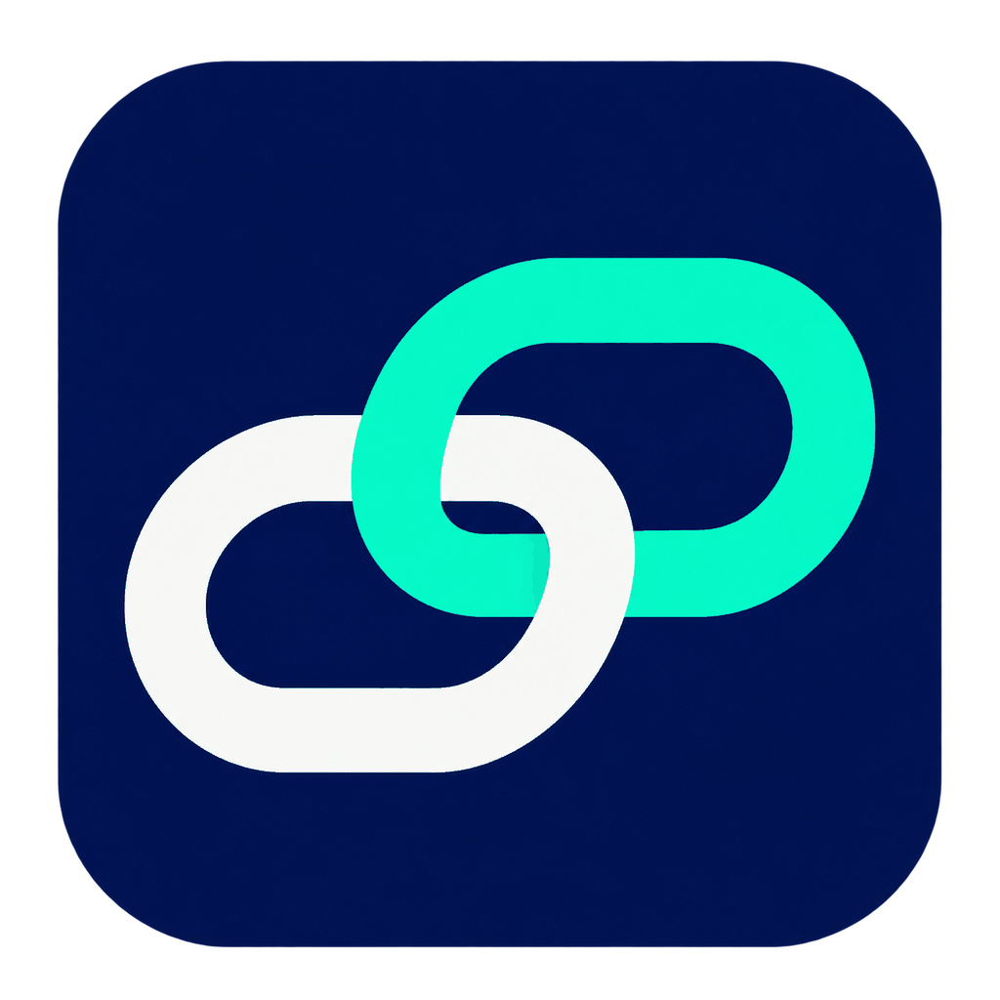

# RobotNet

RobotNet 是一个 Windows 和 macOS 局域网调试工具。将一台电脑用网线接到机械臂或其他以太网设备，就可以在同一局域网的另一台电脑上运行控制程序。

[下载](https://github.com/LONG10222/RobotVirtualSubnetDebugger/releases) · [macOS 源码](https://github.com/LONG10222/RobotVirtualSubnetDebugger/tree/macos-support) · [问题反馈](https://github.com/LONG10222/RobotVirtualSubnetDebugger/issues)

```text
控制程序 → 主机 B（调试端） ── Wi-Fi / LAN ── 主机 A（网关端） ── 网线 ── 机械臂
```

## 安装

| 平台 | 下载文件 | 安装 |
| --- | --- | --- |
| macOS 14+ · Apple Silicon | `RobotNet-<版本>-osx-arm64.zip` | 解压后拖动 `RobotNet.app` 到「应用程序」 |
| macOS 14+ · Intel | `RobotNet-<版本>-osx-x64.zip` | 解压后拖动 `RobotNet.app` 到「应用程序」 |
| Windows x64 | `RobotNet.Windows.Wpf-<版本>-win-x64-self-contained.exe` | 下载后直接运行 |

在 [GitHub Releases](https://github.com/LONG10222/RobotVirtualSubnetDebugger/releases) 选择对应的平台。macOS 使用 `macos-v*` 标签，Windows 使用 `v*` 标签。表中的安装包都包含 .NET 运行时。当前 macOS 预览包采用临时签名，尚未做 Apple Developer ID 公证。

## 快速开始

1. 让两台电脑接入同一个 Wi-Fi 或局域网。用另一块网卡把**主机 A**和设备通过网线连接。
2. 在主机 A 打开「简易模式」，选择「这台电脑连接硬件设备」。填写设备的 IPv4 地址和 TCP 端口，然后点击「配置网口并等待连接」。
3. 在**主机 B**选择「这台电脑运行控制代码」，刷新主机 A 列表，选中网关并点击「连接主机 A 并启动调试通道」。两端使用相同的 UDP 发现端口，默认是 `47831`。
4. 按选用的通信方式配置控制程序。

| 通信方式 | 控制程序连接 | 使用条件 |
| --- | --- | --- |
| 加密 TCP 代理 | 主机 B 的 `127.0.0.1:30003`，端口以应用显示为准 | 主机 A 能访问设备的 TCP 端口 |
| 目标网段路由 | 设备原 IP 和端口，例如 `192.168.1.10:30003` | 两端配置路由模式，局域网和设备网段不同，并授权应用网络配置 |

首次启动时，如果 macOS 只有一个活跃物理网口，应用会预设为主机 B 和 TCP 代理模式。切换到目标网段路由或网关端的完整配置见 [macOS 使用说明](https://github.com/LONG10222/RobotVirtualSubnetDebugger/blob/macos-support/docs/MACOS.md)。

自动配对适用于可信局域网。高级模式支持手动配置共享密钥。TCP 代理负责 TCP 流量，依赖广播、组播或二层发现的设备协议需要其他网络方案。

## 应用内更新

macOS 打开「发布与更新」，依次选择「检查更新」「下载更新」「安装并重启」。应用从 GitHub Releases 匹配本机架构，并使用同一发布的 `checksums-macos.sha256` 校验 ZIP。确认安装后，应用重新启动并读取原有配置。使用期间若启动了代理或应用了系统网络配置，请先停止代理或回滚配置，再安装更新。

macOS 日志位于 `~/Library/Application Support/RobotNet/logs/`。Windows 更新入口提供检查和下载，可退出后手动运行新版本。

## 从源码构建

macOS 使用 [`macos-support` 分支](https://github.com/LONG10222/RobotVirtualSubnetDebugger/tree/macos-support) 和 .NET 10 SDK。

```sh
dotnet run --project RobotNet.Mac
dotnet run --project tests/RobotNet.Mac.Integration -c Release
scripts/publish-macos.sh osx-arm64   # Intel 使用 osx-x64
```

Windows 使用 .NET 8 SDK。

```powershell
dotnet run --project RobotVirtualSubnetDebugger
.\scripts\publish-release.ps1 -SkipSign
```

## 文档与反馈

- [macOS 网口、路由及回滚](https://github.com/LONG10222/RobotVirtualSubnetDebugger/blob/macos-support/docs/MACOS.md)
- [项目路线图](docs/PHASE_ROADMAP.md)
- [macOS 与 Windows 构建检查](https://github.com/LONG10222/RobotVirtualSubnetDebugger/actions/workflows/macos.yml)

提交问题时，请附上系统和应用版本、主机角色、通信方式及相关日志。分享日志前请移除共享密钥、令牌和私人网络信息。
